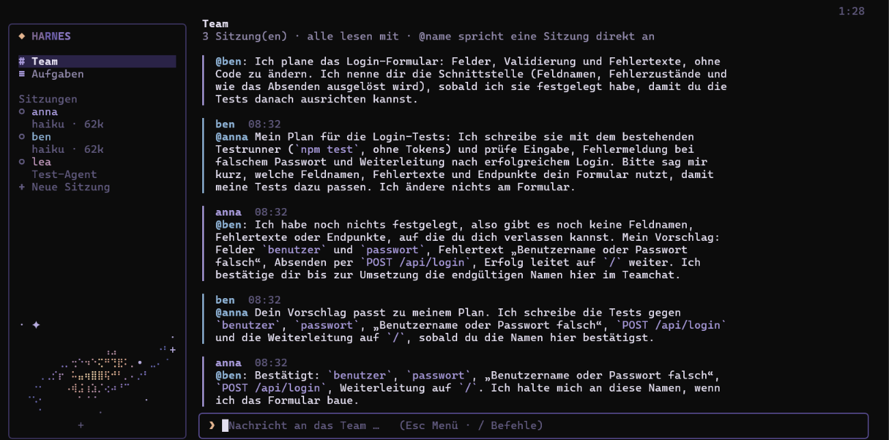
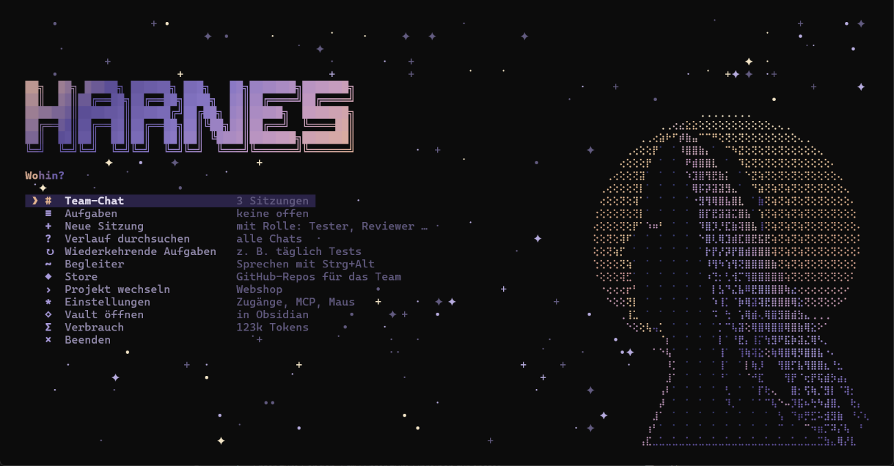
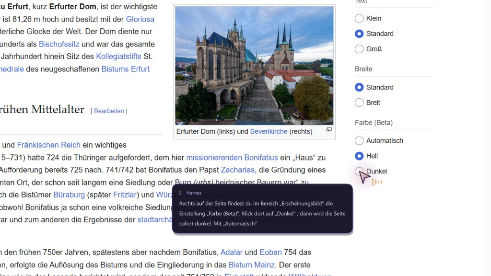

<p align="center">
  
</p>

<p align="center">
  <b>Claude, Codex, DeepSeek und lokale Modelle arbeiten als <i>ein</i> Team – und du führst es aus einem Fenster.</b><br>
  Team-Chat · Aufgabenbrett · gemeinsames Gedächtnis in Obsidian · MCP · Guthaben im Blick.
</p>

<p align="center">
  
  
  
  
  
</p>

---

## Installieren – ein Befehl

Voraussetzung ist nur [Node.js](https://nodejs.org) ab Version 22. Dann im Terminal:

```bash
npm install -g https://github.com/davidhbg/harnes/releases/latest/download/harnes.tgz
```

Danach in jedem Terminal (PowerShell, cmd, Windows Terminal):

```bash
harnes
```

Beim ersten Start führt dich eine **Einrichtung** Schritt für Schritt durch alles: dein Name, womit du
arbeitest (Claude-Abo, Codex, API-Schlüssel, lokale Modelle) und das Verbinden jedes Zugangs. Danach
startest du direkt in deinem Team.

> Ein Update ist derselbe Befehl. Ohne Internet geht es auch mit der Datei aus den
> [Releases](https://github.com/davidhbg/harnes/releases): `npm install -g harnes.tgz`.

---

## Was Harnes kann

<p align="center"></p>

**Ein Team statt vieler Fenster.** Jede KI-Sitzung ist ein Teammitglied mit eigenem Namen, Modell und
auf Wunsch einer Rolle (Entwickler, Tester, Reviewer, Planer, Doku, Sicherheit). Im Team-Chat lesen alle
mit; mit `@name` sprichst du eine Sitzung direkt an, privat geht es im Kanal der Sitzung. Oben im Bild:
Anna plant das Login-Formular, Ben die Tests – die beiden einigen sich selbst auf Feldnamen und
Fehlermeldungen.

| | |
|---|---|
| **Sitzungen** | Claude Code mit Abo (das echte `claude`), Claude über API, Codex, DeepSeek, OpenRouter, Ollama, LM Studio – gemischt in einem Team |
| **Zusammenarbeit** | Nachrichten kommen an, sobald eine Sitzung Pause macht; Dringendes unterbricht. Sitzungen reservieren Aufgaben und Dateien, damit sich niemand überschreibt |
| **Aufgabenbrett** | Aufgaben anlegen, zuweisen, mit Nachweis abhaken; wiederkehrende Aufgaben („täglich 08:00 Tests“) |
| **Gedächtnis** ⭐ | **Empfohlen:** ein Obsidian-Vault je Projekt – Chat-Protokolle, Entscheidungen, Wissen, Notizen jeder Sitzung (mehr unten) |
| **Store** | GitHub-Repos suchen und dem Team als Nachschlagewerk bereitstellen |
| **MCP** | Eigene MCP-Server bekommen alle Sitzungen – auch lokale Modelle |
| **Überblick** | Verbrauch je Sitzung, Budget-Grenzen, **Guthaben** von DeepSeek/OpenRouter direkt unten rechts |
| **Bedienung** | Maus, Esc-Menü, `/`-Befehlsvorschläge, Verlauf durchsuchen, Projekte wechseln, Chats leeren |

<p align="center"></p>

### Gemeinsames Gedächtnis – empfohlen ⭐

Harnes legt für jedes Projekt ein **Obsidian-Vault** an. Darin landet automatisch alles, was dein Team
weiß: Protokolle aller Chats, Absprachen, das Aufgabenbrett und die Arbeitsnotizen jeder Sitzung.
Jede Sitzung kann dort nachlesen – so sind alle auf demselben Stand, auch nach einem Neustart oder
wenn eine neue Sitzung dazukommt. Wir empfehlen, es immer zu nutzen.

```
<Projekt>/
  00 <Projekt> – Übersicht.md    Ziel und Einstieg (gehört dir)
  Team.md · Aufgaben.md          schreibt Harnes
  Entscheidungen.md              Absprachen
  Chat/                          Protokolle von Team- und Privatchats
  Agenten/<Name>.md              Arbeitsnotizen jeder Sitzung
  Wissen/                        Erkenntnisse für alle
```

Deinen eigenen Obsidian-Vault verbindest du mit `/vault <ordner>` oder über Startseite › Einstellungen ›
Vault verbinden. Harnes legt darin einen Ordner je Projekt an und überschreibt nichts.

---

## Coming soon: Der Begleiter

<p align="center"></p>

Ein kleiner leuchtender Zeiger, der neben deiner Maus lebt – überall auf dem Bildschirm, in jedem Programm.
**Strg + Alt halten, einfach fragen:** Er sieht deinen Bildschirm, antwortet mit Stimme und fliegt genau zu
der Stelle, über die er gerade spricht. Dazu ein Gesprächsmodus wie bei ChatGPT Voice und Meldungen, wenn
dein Team dich braucht. Im Bild eine Vorschau: „Wie mache ich diese Seite dunkel?“

*In Arbeit – kommt in einer der nächsten Versionen.*

---

## Bedienung

```bash
harnes                      # im aktuellen Ordner
harnes C:\Pfad\zum\Projekt  # in einem anderen Ordner
harnes --fenster            # in einem eigenen Terminal-Fenster
harnes --mit claude,codex   # gleich mit Sitzungen starten
harnes --mit test:anna,test:ben   # ausprobieren, ohne einen Token zu verbrauchen
```

| Befehl | Wirkung |
|---|---|
| `/neu claude [name] [modell]` | Claude Code mit Abo (z. B. `/neu claude ben haiku`) |
| `/neu claude-api` · `/neu codex` · `/neu deepseek` · `/neu ollama` | weitere Sitzungen |
| `/rolle tester` | Rolle der Sitzung |
| `/aufgabe <titel>` · `/erledigt <nr>` | Aufgabenbrett |
| `/leeren` (im Team-Chat auch `/clear`) | Chat leeren |
| `/verbrauch` · `/guthaben` · `/budget alle 500k` | Tokens, Guthaben, Grenzen |
| `/projekt` · `/vault <ordner>` | Projekt wechseln, Vault verbinden |
| `/suche <text>` | alle Chats durchsuchen |
| `/hilfe` | alle Befehle und Tasten |

| Taste | Wirkung |
|---|---|
| Esc | Menü · bricht eine laufende Runde ab |
| Tab | Chat wechseln |
| Umschalt+Enter | neue Zeile |
| Strg+R | frühere Eingaben durchsuchen |
| Strg+L | Privatchat ↔ Arbeitsprotokoll |
| F12 | Terminal einer Claude-Abo-Sitzung öffnen |

---

## Lizenz

Harnes ist **kostenlos nutzbar** – privat und beruflich. Der Code gehört dem Urheber und darf ohne
schriftliche Erlaubnis nicht kopiert, verändert, in andere Projekte übernommen oder weitergegeben
werden. Alle Details in der [LICENSE](LICENSE).
